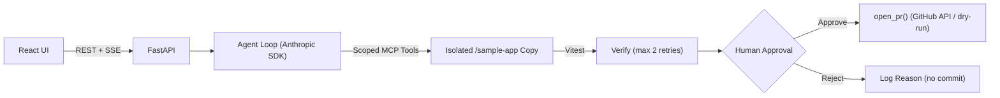

# SDLC Agent Orchestrator

A portfolio demo of an autonomous SDLC agent that picks a ticket (bug or user story) from a mock backlog, plans the change, edits a React + TypeScript sample app through scoped MCP tools, verifies with Vitest, and pauses at a human approval gate before committing or opening a pull request.

> Uses mock data only (`MockShop` storefront and seeded backlog).

## Architecture



See [`docs/architecture.md`](docs/architecture.md) for the detailed component diagram and guardrails.

## Repository Layout

- `sample-app/` — React + TypeScript + Vite mock storefront (`MockShop`) with a passing Vitest suite (7 tests).
- `backlog/` — `stories.json` (10 stories) and `bugs.json` (6 bugs written as user reports).
- `bugs/patches/` — 6 git patches (`BUG-1.patch`..`BUG-6.patch`), each breaking at least one test.
- `stories/tests/` — 10 Vitest acceptance tests (`STORY-1.test.tsx`..`STORY-10.test.tsx`).
- `scripts/` — `apply_case.py <id>` and `reset.py` for isolated working copies.
- `mcp_server/` — Python MCP server (`list_work_items`, `get_work_item`, `read_file`, `write_file`, `run_tests`, `open_pr`).
- `agent/` — Anthropic SDK tool-use loop with planning, retry limits, token/step caps, JSON step logging, and approval gate.
- `api/` — FastAPI backend with SSE live step streaming and `/approve` / `/reject` endpoints.
- `ui/` — Single-page React + TypeScript + Vite UI (backlog list, Run button, live SSE trace, diff viewer, Approve/Reject).
- `evals/` — `cases.jsonl` (15 cases; `BUG-6` held out as smoke test), `run.py`, and `results/latest.md`.
- `tests/` — Unit tests for MCP path scoping, agent loop guardrails, eval runner, and FastAPI endpoints (20 tests).

## Quickstart (Local)

1. **Configure environment**
   ```bash
   cp .env.example .env
   # Set ANTHROPIC_API_KEY (and GITHUB_TOKEN for live PRs)
   ```

2. **Install Python & Node dependencies**
   ```bash
   python3.12 -m venv .venv
   .venv/bin/pip install -r requirements.txt
   (cd sample-app && npm ci)
   (cd ui && npm ci)
   ```

3. **Start the API and UI**
   ```bash
   # Terminal 1
   .venv/bin/uvicorn api.main:app --reload --port 8000

   # Terminal 2
   cd ui && npm run dev
   ```
   Open `http://localhost:5173`.

## Running Tests & Evals

```bash
# Python lint & unit tests (MCP scoping, agent loop, evals, API)
.venv/bin/ruff check api agent mcp_server evals tests scripts
.venv/bin/pytest -v

# Sample app Vitest suite
cd sample-app && npm test

# Run 15-case evaluation suite (dry-run, isolated working copies; requires ANTHROPIC_API_KEY)
.venv/bin/python evals/run.py
# Or run the held-out smoke test:
.venv/bin/python evals/run.py --case BUG-6
```

## Deployment Steps (Docker Compose)

1. Ensure `.env` exists with `ANTHROPIC_API_KEY` and `GITHUB_TOKEN` (and `GITHUB_REPO=owner/repo`).
2. Build and start both containers:
   ```bash
   docker compose up --build -d
   ```
3. Access the UI on port `5173` (Nginx proxies `/api/` to the FastAPI container on port `8000` with buffering disabled for SSE).
4. Check health:
   ```bash
   curl http://localhost:8000/api/health
   ```

## Limitations

- **In-memory run store**: `api/main.py` stores active runs in an in-memory dictionary (`RUNS`), so restarting the API server clears active UI run state (JSON step logs remain on disk under `logs/`).
- **No authentication**: The FastAPI endpoints and React UI have no user authentication; intended for local/demo use only.
- **Symlinked `node_modules`**: `scripts/reset.py` symlinks `sample-app/node_modules` into isolated working copies for speed, assuming the agent does not need to install new npm packages.
- **Live evals require API key**: `evals/results/latest.md` is not populated until `evals/run.py` is executed with a valid `ANTHROPIC_API_KEY`.
- **GitHub workflow push scope**: Updating `.github/workflows/ci.yml` requires a GitHub PAT with the `workflow` scope (or SSH push).
