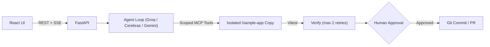

# SDLC Agent Orchestrator

[](https://github.com/varuunnn216/sdlc-agent-orchestrator/actions/workflows/ci.yml)

Autonomous SDLC agent demo that picks a backlog ticket, edits a React + TypeScript storefront through scoped MCP tools, verifies changes with Vitest, and pauses at a human approval gate before committing or opening a PR.

**Live Demo:** https://sdlc-ai-flow.vercel.app/

## What it does
- **Ticket-to-patch agent loop:** Streams live reasoning and tool calls over SSE from FastAPI while an LLM agent plans and implements bug fixes or user stories on an isolated copy of `sample-app/`.
- **Scoped MCP tool server:** Exposes sandboxed file, search, and test tools (`mcp_server/`) so the agent cannot escape the isolated working copy or inherit host secrets during test execution.
- **Automated Vitest verification:** Runs the `sample-app` Vitest suite inside the loop (up to 2 retries on failure) before surfacing the diff.
- **Human-in-the-loop approval gate:** Pauses before any git commit or GitHub PR creation (`ALLOW_REAL_PR=false` by default; uses mock `MockShop` data and seeded backlog).

## Architecture



## Results

Recorded from [`evals/results/latest.md`](evals/results/latest.md) (dry-run, isolated working copies):

| Case | Type | Provider | Model | Result | Agent Failures | Infra Failures |
| :--- | :--- | :--- | :--- | :---: | :---: | :---: |
| `BUG-1` | smoke (`held-out`) | `groq` | `openai/gpt-oss-120b` | `INFRA` (quota limit) | 0 | 1 |

*(Full 15-case evaluation suite requires live LLM API quota; run `python evals/run.py` locally with your own keys to populate complete pass-rate metrics.)*

## Tech stack
- **Backend & Agent:** Python 3.12, FastAPI, SSE, MCP Server, Ruff, Pytest
- **LLM Providers (failover):** Groq (`openai/gpt-oss-120b`), Cerebras (`gpt-oss-120b`), Gemini (`gemini-3.6-flash`), optional Anthropic SDK
- **Frontend & Sample App:** React, TypeScript, Vite, Tailwind CSS, Vitest
- **Deployment:** Docker Compose, Render (`render.yaml`), Vercel (`sdlc-ai-flow.vercel.app`)

## Run locally

1. **Install Python & Node dependencies:**
   ```bash
   python3 -m venv .venv
   source .venv/bin/activate
   pip install -r requirements.txt
   cd sample-app && npm install && cd ..
   cd ui && npm install && cd ..
   ```

2. **Configure environment:**
   ```bash
   cp .env.example .env
   ```
   Env vars in `.env.example`: `LLM_PROVIDER_ORDER`, `GROQ_API_KEY`, `GROQ_MODEL`, `CEREBRAS_API_KEY`, `CEREBRAS_MODEL`, `GEMINI_API_KEY`, `GEMINI_MODEL`, `ANTHROPIC_API_KEY`, `GITHUB_TOKEN`, `GITHUB_REPO`, `ALLOW_REAL_PR`, `DEMO_MAX_RUNS_PER_IP_PER_DAY`, `DEMO_MAX_GLOBAL_RUNS_PER_DAY`.

3. **Start backend & UI:**
   ```bash
   uvicorn api.main:app --reload --port 8000
   # In a second terminal:
   cd ui && npm run dev
   ```
   Open `http://localhost:5173`. Or run both via Docker Compose: `docker compose up --build -d`.

## Tests and evals

```bash
# Python lint & unit tests (MCP scoping, agent loop, evals, API)
.venv/bin/ruff check api agent mcp_server evals tests scripts
.venv/bin/pytest -v

# Sample app Vitest suite
cd sample-app && npm test

# Run 15-case evaluation suite (isolated working copies; requires LLM API key)
.venv/bin/python evals/run.py
# Or run a held-out smoke case:
.venv/bin/python evals/run.py --case BUG-6
```

## Limitations and what I would do next
- **In-memory run store:** `api/main.py` stores active runs in `RUNS`, so restarting the API clears active UI run state (JSON step logs remain under `logs/`). Next: persist run state in Redis or Postgres.
- **No user authentication:** Intended for local/demo use with IP rate limits (`DEMO_MAX_RUNS_PER_IP_PER_DAY`). Next: add GitHub OAuth for multi-user workspaces.
- **Symlinked `node_modules`:** `scripts/reset.py` symlinks `sample-app/node_modules` into isolated copies for speed, assuming no new npm packages are installed by the agent.

## License
[MIT](LICENSE) © 2026 Varun Singh
