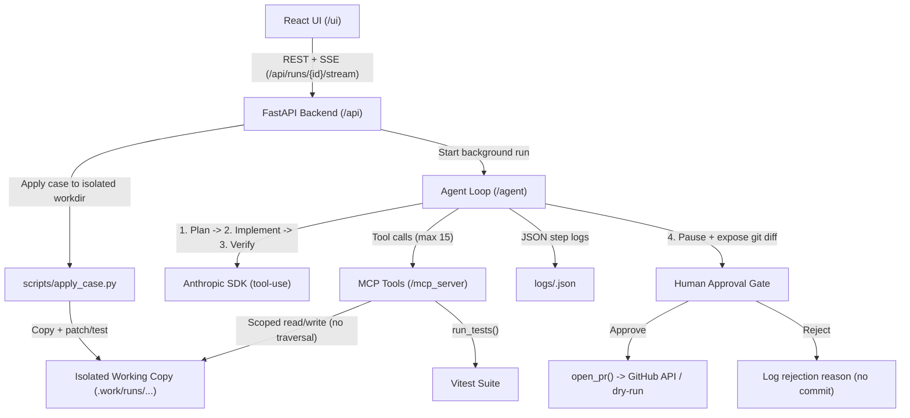

# Architecture — SDLC Agent Orchestrator

## System Overview

The **SDLC Agent Orchestrator** separates ticket orchestration, LLM reasoning, sandboxed file/test execution, and human approval into distinct layers:

## Key Guardrails

1. **Scoped File Access**: `resolve_scoped_path()` in `mcp_server/tools.py` rejects absolute paths, `..` traversal, null bytes, symlink escapes, and writes to `.git` or `node_modules`.
2. **Plan Before Edit**: The agent generates a short implementation plan before any tool calls are made.
3. **Bounded Retries & Budgets**: Each run is capped at 15 tool calls, 50,000 tokens, and 2 retries on `run_tests` failure.
4. **Explicit Approval Gate**: `open_pr` is never exposed to the autonomous loop; commits and PRs only happen after an explicit `/approve` action.
5. **Structured Logging**: Every step (`phase`, `tool`, `args`, `result`, `tokens_in`, `tokens_out`, `duration_ms`) is persisted as JSON.
